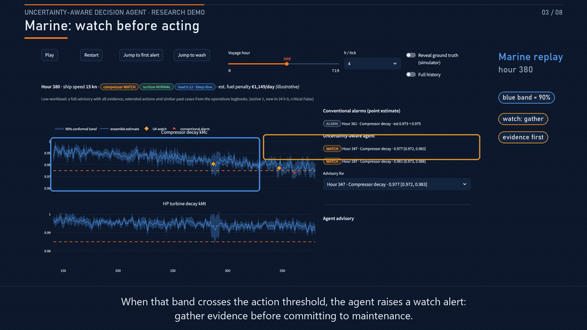

# Uncertainty-Aware Decision Agent — demo

An AI operator assistant that knows — and tells you — how sure it is.
This research demo turns ML point estimates into calibrated uncertainty
intervals, explains alerts with knowledge-base-grounded advisories, and
adapts advisory verbosity to alert pressure.

- **Marine propulsion health**: compressor/turbine decay on a simulated
  naval frigate replay voyage (1 = healthy).
- **Finnish residual-load forecasting**: 3 h-ahead forecasts used for
  fast reserve sizing.

## Demo



- [Watch the full narrated demo (MP4, 1 min 53 s)](deliverables/project_demo_tighter_transitions.mp4)
- [Live app](https://wartsila-conformal-demo.streamlit.app/)

## Run locally

```bash
git clone https://github.com/Princeadhi123/wartsila-conformal-demo.git
cd wartsila-conformal-demo
python -m venv .venv
```

Activate the environment:

```powershell
.\.venv\Scripts\Activate.ps1    # Windows PowerShell
```

```bash
source .venv/bin/activate       # macOS / Linux
```

```bash
python -m pip install -r requirements.txt
python -m streamlit run app/app.py --server.port 8501
```

then open <http://localhost:8501>. The prebuilt pipeline artifacts are
already in `artifacts/` — no regeneration is needed to run the demo.

Tests: `python -m pytest tests -q`.

## Optional LLM advisory (CSC Aitta)

Every advisory can be generated by a fully offline deterministic
composer; no configuration is needed to run the demo. When configured,
the app tries the LLM first and falls back to deterministic advisories
if unavailable; without configuration it runs offline.

The default endpoint is CSC's **Aitta** research inference service:

- base URL `https://aitta-api.csc.fi/openai/v1`
- model `openai/gpt-oss-120b`

Get a token per the [Aitta documentation](https://docs.lumi-supercomputer.eu/laif/inference/aitta/)
and set it for the current session:

```powershell
$env:UAA_LLM_API_KEY = "<your token>"
```

Alternatives: root-level entries in Streamlit secrets (see
`.streamlit/secrets.toml.example`) or a single-line token in
`~/.aitta_token`. `UAA_LLM_BASE_URL` / `UAA_LLM_MODEL` can point at any
other OpenAI-compatible server.

**Never commit API keys** — keep tokens out of git, issues and chat.

## Data and limitations

- **Marine**: UCI Condition Based Maintenance (CBM) dataset — a
  numerical simulator of a naval frigate gas-turbine propulsion plant.
  Coraddu, A., Oneto, L., Ghio, A., Savio, S., Anguita, D., Figari, M.
  (2014), UCI Machine Learning Repository.
- **Energy**: Open Power System Data, `time_series` package
  (2020-10-06 release), Finland — hourly load and wind generation.
  Wiese, F. et al. (2019). Licence: CC-BY-4.0 (data), MIT (code).
- Marine sensor noise is injected synthetically and the knowledge base
  is written for this demo — no Wärtsilä proprietary or manufacturer
  data is used anywhere.
- Fast-start unit size and fuel prices are illustrative UI inputs, not
  measurements.
- This is a research demonstration, not a production safety system;
  the next step is human review and validation with real operators.
