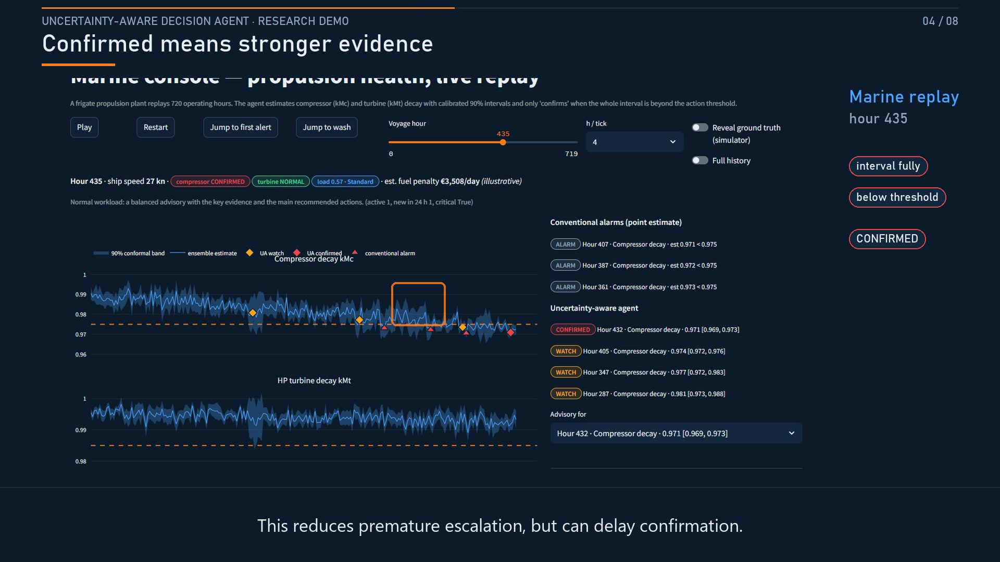

# Uncertainty-Aware Decision Agent — demo

An AI operator assistant that knows — and tells you — how sure it is.

ML ensembles produce point estimates for two operational problems:

- **Marine propulsion health**: gas-turbine compressor decay coefficient
  kMc and HP-turbine decay coefficient kMt on a naval frigate replay
  voyage (1 = healthy).
- **Finnish residual-load forecasting**: 3 h-ahead forecasts used for
  fast reserve sizing.

Split / locally-adaptive conformal prediction and CQR with online
adaptive conformal inference turn the estimates into intervals with a
stated coverage guarantee. Alerts are raised on interval evidence
(confirmed / watch), a retrieval agent explains each alert with
troubleshooting steps cited to a knowledge base, and an operator-load
router adapts advisory verbosity to alert pressure.

## Demo video

[](https://github.com/Princeadhi123/wartsila-conformal-demo/blob/master/deliverables/project_demo_tighter_transitions.mp4)

- [Watch the demo video (MP4, 1 min 53 s)](deliverables/project_demo_tighter_transitions.mp4) —
  narrated walkthrough of both consoles.
- [Subtitles](deliverables/project_demo_tighter_transitions.srt)
- [Narration script](deliverables/project_demo_polished_script.md) —
  the script retains the original two-minute scene timings; the video
  and subtitles use the tighter revised timing.

Live app: <https://wartsila-conformal-demo-nhesdmgklkaaibyygl4ykn.streamlit.app/>.
If the hosted app is unavailable, use the video or run locally.

## Quick start

```bash
git clone https://github.com/Princeadhi123/wartsila-conformal-demo.git
cd wartsila-conformal-demo
python -m venv .venv
```

Activate the environment:

```powershell
.\.venv\Scripts\Activate.ps1    # Windows PowerShell
```

```bash
source .venv/bin/activate       # macOS / Linux
```

```bash
python -m pip install -r requirements.txt
```

The prebuilt pipeline artifacts are already in `artifacts/` — no
regeneration is needed to run the demo. To regenerate them (~2–4 min
total; this downloads the public source data, so network access is
needed for regeneration, not for default use):

```bash
python scripts/run_pipeline.py
```

Run the demo app:

```bash
python -m streamlit run app/app.py --server.port 8501
```

Convenience launchers do the same thing:

```powershell
.\run_demo.bat    # Windows PowerShell
```

```bash
./run_demo.sh     # macOS / Linux
```

then open <http://localhost:8501>. Tests: `python -m pytest tests -q`.

## Streamlit Community Cloud

Deploy with: repository `Princeadhi123/wartsila-conformal-demo`, branch
`master`, main file `app/app.py`, dependencies from the root
`requirements.txt` (which includes `plotly==6.1.1`). The prebuilt
artifacts are committed, so the app does not run the pipeline at
startup.

Troubleshooting: if a `ModuleNotFoundError` occurs at `import plotly...`,
check **Manage app → Logs** for the deployed branch/commit, dependency
installation and any installation failure. An outdated deployment or
incomplete dependency installation may be responsible; reboot after
correcting the deployment, but note that a reboot alone may not rebuild
the dependency environment.
The app never installs packages at runtime, and the optional LLM
advisory still falls back to the offline composer without secrets (see
below).

## Optional LLM advisory (CSC Aitta)

By default every advisory is written by a deterministic, fully offline
extractive composer. You can optionally route the advisory text through
CSC's **Aitta** research inference endpoint — a remote service; the model
does **not** run on your machine:

- base URL `https://aitta-api.csc.fi/openai/v1`
- model `openai/gpt-oss-120b`

Get a token per the [Aitta documentation](https://docs.lumi-supercomputer.eu/laif/inference/aitta/)
and configure it in one of three ways — first match wins per key:
environment variables, then Streamlit secrets, then the token file.

```powershell
# Windows PowerShell, current session only
$env:UAA_LLM_API_KEY = "<your token>"        # $env:AITTA_KEY also works
# Endpoint and model default to CSC Aitta once any token is present;
# set them only to target a different OpenAI-compatible server:
$env:UAA_LLM_BASE_URL = "https://aitta-api.csc.fi/openai/v1"
$env:UAA_LLM_MODEL = "openai/gpt-oss-120b"
```

or store just the token as a single line in `%USERPROFILE%\.aitta_token`
(`~/.aitta_token`). On Streamlit Community Cloud, paste the keys into
**Manage app → Settings → Secrets** as root-level TOML (see
`.streamlit/secrets.toml.example`; `secrets.toml` itself is git-ignored):

```toml
UAA_LLM_BASE_URL = "https://aitta-api.csc.fi/openai/v1"
UAA_LLM_MODEL = "openai/gpt-oss-120b"
UAA_LLM_API_KEY = "<your token>"
```

Notes:

- Never paste tokens into git, issues or chat. If a token is ever
  exposed, rotate it before reusing it.
- `openai/gpt-oss-120b` is selected for responsiveness, but a fast reply
  is not guaranteed: the endpoint can be offline or cold, and the first
  request after idle may still be slow.
- Aitta is a research service with no availability guarantee. The first
  request after idle can be slow and online latency varies; measured
  request time is shown under each advisory ("original request; cached
  results reuse this timing"). Initial local GPT-OSS requests timed out
  after 31.05 s and 30.04 s; CSC subsequently reported the worker as
  `requested`, not running. These are startup-wait observations, not
  successful generation times. See [latency observations](docs/LLM_LATENCY.md).
- Requests use a 30 s connect/read inactivity timeout (not a hard
  end-to-end deadline) with no retries. If the model
  is unreachable or returns an unusable answer, the app warns with a
  categorical reason (e.g. `timeout`, `rate limited`) and falls back to
  the deterministic offline advisory — the `Generator:` caption shows
  which path produced the text (`llm:<model>` vs `offline-extractive`).
- Advisories are cached for 5 minutes per alert/mode/endpoint, including
  failed attempts.

## Data sources

- **Marine**: UCI Condition Based Maintenance (CBM) dataset — a
  numerical simulator of a naval frigate gas-turbine propulsion plant.
  Coraddu, A., Oneto, L., Ghio, A., Savio, S., Anguita, D., Figari, M.
  (2014), UCI Machine Learning Repository.
- **Energy**: Open Power System Data, `time_series` package
  (2020-10-06 release), Finland — hourly load and wind generation used
  to derive residual load. Wiese, F. et al. (2019), *Energy Strategy
  Reviews* 27, 100420. Licence: CC-BY-4.0 (data), MIT (code).
- **Knowledge base**: synthetic markdown documents written for this
  demo from general, publicly known engineering practice — not
  manufacturer documentation.

## Method references

See `src/uaagent/conformal.py` docstring: split conformal (Vovk et al.
2005; Lei et al. 2018), normalised/locally-adaptive conformal
(Papadopoulos et al. 2008), conformalized quantile regression (Romano,
Patterson & Candes 2019), adaptive conformal inference (Gibbs & Candes
2021).

## Project structure

```
app/            Streamlit demo (5 pages, live replay consoles)
  app.py        entry point: streamlit run app/app.py
  common.py     loaders, colors, advisory renderer
  page_*.py     Overview / Marine / Energy / Trust & validation / Pilot
artifacts/      pipeline outputs (CSVs, metrics JSON, calibration scores)
data/raw/       public datasets (not committed)
deliverables/   demo video, subtitles, poster, narration script
docs/           meeting/demo script, LLM latency observations
kb/             synthetic knowledge base (markdown, cited by advisories)
scripts/        run_pipeline.py (regenerates artifacts)
src/uaagent/    data.py · conformal.py · marine.py · energy.py
                rag.py · agent.py · alerts.py · routing.py
tests/          pytest suite (conformal, rag/agent, alerts, app)
```

## Limitations and assumptions

- Marine sensor noise is injected synthetically (documented relative
  noise levels per instrument class); the replay voyage's ground truth
  is only known because the data comes from a simulator.
- The Finnish track uses public system-level data only — no weather
  forecasts or plant-level signals — so intervals are calibrated but
  not yet sharp.
- Fast-start unit size (20 MW) and fuel price (€700/t) are illustrative
  UI inputs, not measurements.
- The knowledge base is synthetic; no proprietary or manufacturer data
  is used anywhere in the demo.
- This is a research demonstration, not a production safety system; the
  next step is human review and validation with real operators.
